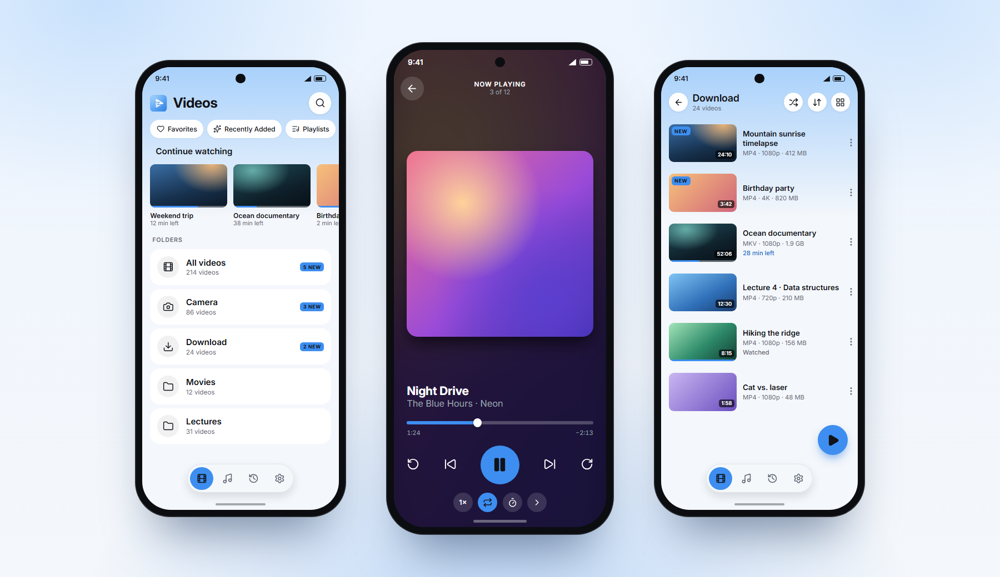

<p align="center">
  
</p>

<h1 align="center">ZX Player</h1>

<p align="center">
  A fast, minimal video and audio player for Android.<br>
  Works fully offline. Free, with no ads.
</p>

<p align="center">
  <a href="https://github.com/IsHereZahin/ZX-Player/releases/latest/download/ZX-Player.apk"><b>Download APK</b></a>
  ·
  <a href="https://zx-player.vercel.app">Website</a>
  ·
  <a href="https://github.com/IsHereZahin/ZX-Player/releases">All releases</a>
</p>



## Features

- **Your library, at once:** folders, All videos and All audio, Continue watching, Favorites, Recently Added, playlists and search. New files get a "NEW" tag.
- **A capable player:** swipe for brightness, volume and seeking, double-tap to skip, hold for 2× speed and pinch to zoom. Speed, repeat, a sleep timer, picture-in-picture, subtitles (embedded, `.srt`, `.ass`, `.ssa`) and audio tracks.
- **Music too:** an audio player with album art that keeps playing in the background, with notification and lock-screen controls.
- **Tidy up safely:** on Android 11+, copy, move or delete files. Deleted files wait 30 days in the Recycle Bin.
- **Five colour themes,** each in light and dark.
- **Private:** no account, no ads, nothing uploaded. The app only goes online when you tap **Check for Updates**.

## Install

1. Download **ZX-Player.apk** from the [latest release](https://github.com/IsHereZahin/ZX-Player/releases/latest).
2. Open it. If Android asks, allow your browser to install unknown apps.
3. If Google Play Protect shows a warning, choose to install anyway.

Needs Android 7.0 or newer. Updates install over the existing app and keep your settings, history and playlists. **Settings → About ZX Player → Check for Updates** tells you when a new version is out.

## Build from source

```sh
npm install
npm run android
```

Built with React Native (New Architecture), TypeScript and `react-native-video` (Media3). Architecture, release steps and other notes are in [docs/DEVELOPMENT.md](docs/DEVELOPMENT.md).

## Author

Made by **Zahin Mohammad**: [Facebook](https://www.facebook.com/isherezahin).
